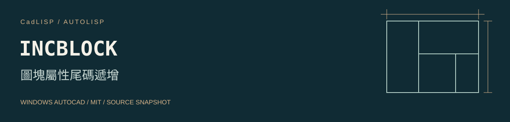

# INCBLOCK 圖塊屬性尾碼遞增



[工具儲存庫](https://github.com/whos-dwg/CadLISP-IncBlock) · [全部工具索引](https://github.com/whos-dwg/CadLISP-Index)

讀取來源屬性尾端數字，連續插入同名圖塊並遞增，其他屬性沿用原值。

**使用前需處理：** 原碼開頭及還原處使用 `ATREQ`，插入前設定的卻是標準變數 `ATTREQ`。可能在起始 getvar 即失敗；應統一拼字後測試正常結束、Esc、錯誤與變數還原。[ATTREQ 官方說明](https://help.autodesk.com/cloudhelp/2020/ENU/AutoCAD-Core/files/GUID-7A7229F8-C99D-42C5-8784-4231767611F8.htm)。

| 項目 | 內容 |
| --- | --- |
| 指令 | `INCBLOCK` |
| 檔案 | [Incblock.lsp](lsp/Incblock.lsp) |
| 分類 | 屬性與編號 |
| 狀態 | 有待修正的原碼問題 |
| 授權 | [MIT](LICENSE)，Copyright (c) 2026 whos-dwg |

[安裝](#安裝) · [操作](#操作) · [相依與設定](#相依與設定) · [已知問題](docs/KNOWN_ISSUES.md) · [驗證紀錄](docs/VALIDATION.md)

## 安裝

以 Windows 桌面版 AutoCAD 為目標。原碼使用的 Visual LISP／ActiveX、DCL 或原生命令，需在目標 AutoCAD 版本分別確認；尚未做整包年份、LT、Mac 或其他 CAD 的相容性認證。ActiveX 的平台限制見 [Autodesk](https://help.autodesk.com/cloudhelp/2026/ENU/AutoCAD-AutoLISP/files/GUID-A0459510-CE7A-4206-9EAA-E25AAB569B20.htm)。

1. 下載並解壓縮本工具到固定位置，先開啟測試圖面。
2. 依公司環境把 `lsp` 資料夾加入需要的支援搜尋路徑與受信任位置。
3. 輸入 `APPLOAD`，載入 `Incblock.lsp`；關閉視窗後輸入 `INCBLOCK`。

也可使用完整路徑單獨載入；下列路徑需依實際位置修改：

```lisp
(load "C:/CAD/CadLISP-IncBlock/lsp/Incblock.lsp")
```

完成驗證後，可將這支 LISP 加入 APPLOAD 的 Startup Suite。請維持既定的 SECURELOAD 政策，使用受信任位置處理載入限制。[SECURELOAD 說明](https://help.autodesk.com/cloudhelp/2026/ENU/AutoCAD-Core/files/GUID-541566C6-2738-49DD-87C3-C1490E924A02.htm)。

## 操作

1. 修正並驗證 ATREQ 問題後，輸入 `INCBLOCK`。
2. 精確點選圖塊中的屬性文字，內容必須以數字結尾，例如 A-009。
3. 連續點選插入位置，預期產生 A-010、A-011；按 Enter 或 Esc 結束並檢查系統變數。

## 相依與設定

原碼含 ATREQ／ATTREQ 拼字不一致，需先修正並測試，見已知問題；本包保留原碼。

圖面影響：新增圖塊並修改新增圖塊的屬性。

## 行為與限制

原碼以縮放 1、旋轉 0 重新插入同名圖塊，不保證複製來源圖塊的縮放、旋轉與動態參數。此項為待修正工具，不能標示為已通過執行測試。

## 來源與授權

本工具依維護者確認為自行從零撰寫，或以 AI 協作從零開發。程式與本次文件採 [MIT 授權](LICENSE)，允許使用、修改與再散布，須保留授權及著作權聲明。詳細來源紀錄見 [provenance.json](metadata/provenance.json)。

## 回報與維護

回報時附 AutoCAD 完整版本、命令列錯誤與去識別的重現範例。修改前請閱讀 [CONTRIBUTING](CONTRIBUTING.md)；發行步驟見 [PUBLISHING](docs/PUBLISHING.md)。本工具可獨立維護、下載及發布，不依賴其他 CadLISP 工具儲存庫。
